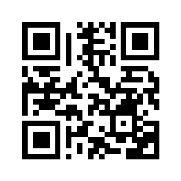

**Yes, you can scan a QR code without installing another app.** For a printed code or one on another screen, try your phone's built-in camera. For a code saved on the same phone, use an image reader in your browser instead of trying to point the camera at your own screen.

[Open ScanApp's QR scanner](/) to read a code with your camera or choose **Upload Image** to read a saved picture. No ScanApp account or app installation is required.

## Choose the method that fits your code

- **Printed code or another screen:** use your phone camera, or ScanApp's camera mode.
- **Screenshot, email attachment or photo on this device:** save the picture, then choose **Upload Image** on ScanApp.
- **Laptop or desktop:** choose **Upload Image** for a saved picture, or use a webcam for a printed code.
- **Code inside a PDF:** use the [PDF QR reader](/scan-qr-code-from-pdf/) and select the page containing the code.

## Scan a printed QR code with your phone camera

### iPhone or iPad

1. Open **Camera** and use Photo mode.
2. Hold the device so the whole QR code appears in the frame.
3. Tap the link that appears if you want to open it.

Apple also provides a Code Scanner control. See [Apple's camera and Code Scanner instructions](https://support.apple.com/en-us/102680).

### Android

Camera features vary by phone. On a Pixel, open **Camera**, point it at the entire code and tap the link that appears. If recognition is disabled, check **Camera scan suggestions** in the camera settings. Google's [Pixel QR scanning instructions](https://support.google.com/pixelcamera/answer/16561572?hl=en) also describe the Quick Settings scanner.

If your phone does not offer a scanner, you can use ScanApp in your browser. You do not need to install another app to use its camera or image mode.

## Read a QR code from a screenshot on the same phone

You do not need a second device or camera access for this method.

1. **Save the image.** Take a screenshot or save the picture from your email, browser or chat. Keep the entire code and the clear border around it.
2. **Open [ScanApp](/) and choose Upload Image.** Select the saved picture from your device's file or photo picker.
3. **Check the result.** ScanApp displays the decoded text. If it contains a web address, inspect the domain before choosing **Open**. You can also copy the result.

The image is decoded in your browser; ScanApp does not upload it for decoding. The website still makes requests to load its resources and analytics. Opening a decoded link visits that destination.

For more detail, see [reading QR codes from images and photos](/supports/how-to-scan-qr-code-from-image-or-photo).

## Try it with a sample QR code

This sample contains exactly **https://scanapp.org/**. Use it to check the image workflow before scanning your own code.

<figure style="margin:1.5rem 0;padding:1.25rem;border:1px solid var(--blog-border, #cbd5e1);border-radius:12px;text-align:center;">
  
  <figcaption style="margin-top:1rem;">Expected result: <strong>https://scanapp.org/</strong></figcaption>
</figure>

1. <a href="/assets/samples/scanapp-qr.png" download="scanapp-qr.png">Download the sample QR image</a>. If your browser opens the picture instead, use its save-image option.
2. [Open the scanner](/), choose **Upload Image**, and select the downloaded sample.
3. Confirm that the decoded address matches **https://scanapp.org/**. There is no need to open the link to check the result.

This is a simple example, not a guarantee that every damaged, blurred or unusually styled code can be read.

## Use a browser camera instead

1. Open [ScanApp](/) and stay in camera mode.
2. Allow camera access if you want to use that method, then select the appropriate camera if prompted.
3. Hold the whole code in view with good lighting and wait for the result.

If camera access is unavailable, use **Upload Image** with a saved picture. See [camera permission help](/supports/how-to-unblock-camera-permissions-web-qr-code-scanner) for troubleshooting.

## If the code will not scan

- Use the original image where possible. A small thumbnail or heavily compressed screenshot may lose detail.
- Include the full square and its border. Crop away unrelated content without cutting into the code.
- For a camera scan, reduce glare, hold steady and let the camera focus.
- For a screenshot, try a clearer or larger copy. Enlarging a blurred image does not restore missing detail.
- If the sample works but your code does not, the original may be damaged or unsupported. [Contact me](/contact/) to report a problem or request a feature.

Decoding shows what a QR code contains. It does not verify the sender, a payment request, a ticket or the safety of the destination. Check the result before acting on it.
