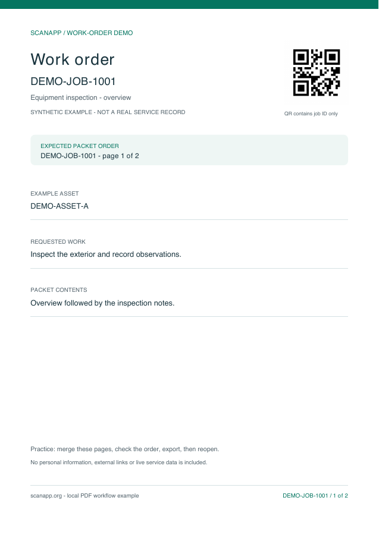

If you need to combine several work-order PDFs for filing or handover, you can arrange their pages and export a copy in your browser. This walkthrough uses two fictional job packets so you can check the result before working with your own documents.

The workflow is **manual**: you choose the documents, review their order and save the output. ScanApp does not automatically sort documents by job ID, name the resulting files or produce an inventory spreadsheet.

## Download the practice files

These small, unprotected PDFs contain synthetic work orders, with no real customer information. The QR codes contain only the printed demo job IDs.

| File | Contents | Pages |
|---|---|---:|
| [Job 1001: overview and notes](/assets/examples/work-order-pdfs/demo-job-1001.pdf) | `DEMO-JOB-1001` overview, then inspection notes | 2 |
| [Job 1002: overview](/assets/examples/work-order-pdfs/demo-job-1002.pdf) | `DEMO-JOB-1002` overview | 1 |

Save both PDFs to your device. If a link opens a PDF preview, use your browser's download or save option.

<figure style="margin:1.5rem 0;padding:1rem;border:1px solid var(--blog-border, #cbd5e1);border-radius:12px;text-align:center;">
  
  <figcaption style="margin-top:0.75rem;">The sample's printed job ID, page label and QR contents give you separate checks on the exported packet.</figcaption>
</figure>

## Combine the two job packets

1. Open [Merge PDFs](/pdf-tools/merge/) and choose **Open PDFs**.
2. Select the downloaded Job 1001 PDF first. Check that the workspace contains its two pages.
3. Choose **Add PDFs / merge** and select Job 1002. You should now have three pages.
4. Review the page list and preview. Select a page and use **Move earlier** or **Move later** if you need to correct the order.
5. Leave **Export pages** empty to include all three pages, then choose **Download edited PDF**.
6. Open the downloaded file, normally named `scanapp-edited.pdf`, and check its contents before renaming or sharing it.

The expected order is:

| Exported page | Job ID | Page content |
|---:|---|---|
| 1 | `DEMO-JOB-1001` | Work-order overview, page 1 of 2 |
| 2 | `DEMO-JOB-1001` | Inspection notes, page 2 of 2 |
| 3 | `DEMO-JOB-1002` | Work-order overview, page 1 of 1 |

Compare your output with the [three-page reference packet](/assets/examples/work-order-pdfs/reference-merged.pdf) or the [plain-text expected order](/assets/examples/work-order-pdfs/expected-order.txt). The reference is for checking content and page order; your exported PDF does not need to be byte-for-byte identical.

## Extract one job for a separate handover

1. Open [Split and extract PDF pages](/pdf-tools/split/) and load the three-page file you just exported.
2. Enter `1-2` in **Export pages** and choose **Download edited PDF**.
3. Reopen the output. It should contain only the two Job 1001 pages, with the overview before the inspection notes. Here is the [two-page reference result](/assets/examples/work-order-pdfs/reference-job-1001.pdf).
4. To save Job 1002 separately, change the range to `3` and export again. Each range refers to the current workspace order.

The original downloaded files remain unchanged. Save each exported copy with a useful filename yourself; ScanApp does not automatically name files using job IDs.

## Check a QR job identifier

Open the merged packet in the [PDF QR reader](/scan-qr-code-from-pdf/). Select page 1 and choose **Read QR code**. The expected text is `DEMO-JOB-1001`. On page 3, the expected text is `DEMO-JOB-1002`.

The reader processes **one readable QR code on the selected page**. It does not scan the entire document automatically, read every barcode type, verify a service record or check a job against a business system. Page 2 of this sample has no QR code; its printed job ID and page label are the checks to use there.

## Before using real work orders

- Keep your originals and reopen every exported file to check page order, missing pages and legibility.
- The PDF workspace accepts unprotected PDFs up to 40 MB and 200 pages combined. The separate PDF QR reader accepts a PDF up to 20 MB and 200 pages.
- Password-protected PDFs and signature-field documents are not supported by the workspace. Supported form fields become flat visible content during export. Existing bookmarks, attachments and document-level metadata are not promised to survive merging.
- Document processing stays on your device. Loading the website still requests its resources and analytics; opening a link inside a document visits that destination.
- For offline PDF editing, complete **Enable offline use** in the workspace while connected and wait for **Ready offline**. Download the practice files before disconnecting. Browser storage cleanup can remove the offline files.

If your team's job is instead to automatically separate hundreds of packets, match identifiers to a register or export checked rows, [contact me](/contact/) with the workflow you need. Describe the required output and how often the task occurs; you do not need to send customer documents to explain it.
